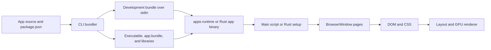

# Architecture

`@pierre/apps` is a Rust desktop runtime with Electron-compatible APIs. It ships JavaScriptCore and implements its own DOM, CSS, layout, and GPU renderer. Rust and JavaScript modules provide the Web and Node APIs.

`BrowserWindow` uses this custom renderer. `WebContentsView`, `<webview>`, and `<iframe>` use the system web view. These are separate paths with different capabilities. [COMPATIBILITY.md](COMPATIBILITY.md) describes the supported APIs and their limits.

## Source layout

| Path | Responsibility |
|---|---|
| [crates/cli](crates/cli) | The `apps` command, module bundler, development loop, app packages, and AOT compiler integration |
| [crates/runtime](crates/runtime) | App lifecycle, JavaScriptCore, Electron and Node APIs, DOM, CSS, and page rendering |
| [crates/renderer](crates/renderer) | Native windows, input, retained box trees, Taffy layout, text, atlases, and GPU backends |
| [crates/webview](crates/webview) | System web views and their native bridge |
| [crates/webgpu](crates/webgpu) | The optional WebGPU API through wgpu |
| [crates/media](crates/media) | The optional audio and video player through FFmpeg and cpal |
| [crates/perfhud](crates/perfhud), [crates/mcp](crates/mcp) | Development tools: the FPS HUD and devtools server |
| [packages](packages) | npm launcher, TypeScript declarations, and packages for each platform and architecture |
| [scripts](scripts) | JavaScriptCore, FFmpeg, and npm package builds |

The runtime separates JavaScript API objects from native state. [js](crates/runtime/js) contains the API implementations and event loop. [src/jsc](crates/runtime/src/jsc) connects them to Rust and checks access by context role. [Host](crates/runtime/src/host.rs) owns app metadata, page documents, native resources, and commands.

## Build and startup

The [bundler](crates/cli/src/bundler/mod.rs) uses Oxc to parse, transform, and minify JavaScript, TypeScript, and JSX. It resolves dependencies separately for main, preload, and page code. It also processes HTML, CSS, assets, workers, native addons, and custom loaders.

The bundler maps `electron` and `@pierre/apps` imports to runtime APIs. Literal `import.meta.resolve()` calls identify pages or script chunks. Literal `loadFile()` calls in main code also include the target HTML and its dependencies in the bundle.

JavaScript apps use `apps-runtime` as their executable and `app.js` as their main entry. Apps with `"type": "rust"` use a Cargo binary linked to `apps-runtime`. Their entry calls `app::run()`, creates windows, and registers native handlers through the [Rust app API](crates/runtime/src/desktop/app.rs).

### Module execution

Development bundles use module factories, namespace objects, and export getters. Production bundles use plain functions and shared export slots for eligible modules. The bundler resolves re-exports to their source bindings. Mutable exports retain accessors when necessary.

Modules with cycles, CommonJS, top-level await, or other incompatible constructs retain the general module loader. [modules.js](crates/runtime/js/modules.js) executes the bundle and loads script chunks.

### App bundle

[bundle.rs](crates/runtime/src/bundle.rs) defines `app.bundle`. It starts with an eight-byte header: `APP\0` and a format version. Postcard data follows the header:

- Files: main code, script chunks, package metadata, asset maps, and native addons.
- Pages: parsed HTML documents, stylesheets, and inline style declarations.
- Optional bytecode: an index followed by blocks at eight-byte aligned offsets.

Asset files remain beside the bundle. The runtime maps `app.bundle` into memory and retains script chunks as slices of that mapping. JavaScriptCore can read ASCII sources and bytecode in place. New builds replace the bundle file because an active app can still hold its mapping.

On macOS, the package uses `Contents/MacOS`, `Contents/Resources`, and `Contents/Frameworks`. Windows and Linux packages keep the executable, bundle, and required libraries in the output directory. [packaging.rs](crates/cli/src/packaging.rs) selects the libraries from the app features and build mode.

### JavaScriptCore build modes

The runtime loads its own JavaScriptCore library from Bun's WebKit fork. [build-jsc.sh](scripts/build-jsc.sh) builds it with [jsc.patch](scripts/jsc.patch) and the generic event loop. The runtime supplies timers, task queues, native operations, and microtask checkpoints.

| Mode | Execution |
|---|---|
| Default | JavaScriptCore compiles source at runtime. Runtime scripts share a bytecode cache across VMs. |
| `--bytecode` | The build stores bytecode for runtime scripts, main code, and eligible chunks in `app.bundle`. |
| `--aot` | The build compiles app code and runtime scripts into `app.dylib`, paired with `libJavaScriptCoreAOT.dylib`. |

AOT currently requires a native macOS arm64 build and a JavaScript or TypeScript main entry. The CLI rejects `--aot` and `--bytecode` together. If `jsExecute` or `httpImport` is enabled, the CLI warns and uses the default build mode.

The [AOT path](crates/cli/src/aot.rs) uses Bun's Rust frontend and the JavaScriptCore compiler library. Build identifiers and a hash of runtime scripts connect the compiled image to the correct runtime.

## Threads and ownership

On macOS, the main thread owns AppKit and each `BrowserWindow` has a render thread.

| Thread | Work |
|---|---|
| Main | Native windows, menus, system web views, and the main script or Rust setup callback |
| Per-window render | Page and preload contexts, their JavaScriptCore VM, event loop, DOM, CSS, layout, and Metal frames |
| Rust handler pool | `ipcRenderer.invoke()` handlers registered with `App::handle()`, on up to four threads |
| Shared blocking pool | Async file, DNS lookup, crypto, zlib, and Node-API work, on up to four threads |
| Network | A shared Tokio runtime for HTTP, WebSocket, TCP, and server I/O |
| JavaScript workers | One thread and JavaScriptCore VM per worker |

On Windows and Linux, main code and window pages share the main thread. A busy script can delay all page frames there. The handler pool, blocking pool, network thread, and workers remain separate.

A page and its preload have separate globals but share a VM and host. On macOS, that VM belongs to their render thread. Main and render threads exchange commands and payloads through [desktop/link.rs](crates/runtime/src/desktop/link.rs). JavaScript objects do not cross these queues. The runtime uses threads within one process, so a native crash can end the whole app.

### Events and communication

[bootstrap.js](crates/runtime/js/bootstrap.js) manages timers and task phases. Native completion events wake the thread that owns the context. The desktop loop arms the next timer and requests a frame only when the page needs one. Each task has a microtask checkpoint.

[bridge.js](crates/runtime/js/bridge.js) implements IPC and `contextBridge`. IPC values follow structured clone semantics. The context bridge also supports function and promise proxies between page and preload contexts. Rust handlers accept JSON values. `AppHandle` lets Rust threads send events to pages or request app exit.

Synchronous page calls, such as `ipcRenderer.sendSync()` and `window.open()`, can wait for main. On macOS, native input and IME queries wait at most 100 ms for a page. Live resize waits at most 8 ms for a frame. Main continues native work during these waits.

Window commands execute on main. Close and quit requests interrupt page JavaScript so a hung page script cannot prevent shutdown. Native calls and addons still execute on the thread that calls them.

Main dispatch uses common run loop modes, so native work continues inside modal dialogs and menus. A nested loop defers events that require re-entry into main JavaScript. `before-input-event` also skips main JavaScript during such a loop.

## Context roles and feature flags

The runtime defines three [roles](crates/runtime/src/host.rs): main, preload, and renderer. The bundler checks module access, and the native bridge checks each operation again.

- Main code can use desktop APIs and the supported Node APIs.
- Preloads can use the supported Node APIs and a limited Electron API. Their `document` proxy accesses the page through the context bridge.
- Page code gets Web APIs and APIs that its preload explicitly exposes. It has no direct Node or native bridge access.

Preloads run only for bundled pages and files inside the app directory. HTML strings and external files receive no preload. A page reaches its preload through the context bridge, and the preload reaches main through IPC.

The `features` array in `package.json` controls optional behavior. All entries in [FEATURES](crates/runtime/src/bundle.rs) default to disabled.

| Feature | Effect |
|---|---|
| `jsExecute` | Permits page code generation, such as `eval()` and `new Function()`, and imports from `data:` or `blob:` URLs |
| `httpImport` | Permits remote JavaScript and CSS imports |
| `localNetwork` | Permits page access to private network addresses |
| `webgpu` | Enables the WebGPU API |
| `video`, `audio` | Enable the media player |
| `reactCompiler` | Enables the Oxc React compiler for app page modules |

Without `localNetwork`, page fetch and WebSocket connections reject private addresses except loopback ports that the app itself serves. System web views use their own engine and security model.

## Page rendering

The custom page pipeline has four stages:

1. [DOM](crates/runtime/src/dom) stores nodes, attributes, text, state, and revision counters. JavaScript wrappers in [dom.js](crates/runtime/js/dom.js) expose these nodes to page code.
2. [Style](crates/runtime/src/style) matches selectors and computes the cascade, inheritance, custom properties, animations, and Tailwind utilities.
3. [Render](crates/runtime/src/render) converts styled DOM nodes into renderer nodes, text, controls, images, and effects.
4. [Renderer](crates/renderer/src) retains the box tree, computes Taffy layout, shapes text, and submits GPU commands.

The runtime owns HTML and CSS behavior. The renderer owns windows and the lower-level box, text, and graphics APIs.

### Incremental work

DOM revisions and selector dependencies limit style updates to affected nodes. Computed styles use chunks with copy-on-write storage. A viewport or stylesheet change can require a full style pass.

The document keeps a short log of the nodes that changed. A tree change patches the list of nodes in document order, and reports the nodes that moved, joined or left. The style, visibility and culling passes then visit only these nodes and the nodes with a new style. A change to most of the tree uses the full passes, and so do the style lists of a page with shadow trees. Debug builds compare each patched result with a full pass.

Each render subtree records its inputs: styles, dimensions, ancestor data, scroll state, and resource sizes. If those inputs match, `Child::Kept` reuses the previous subtree. Changed boxes invalidate their layout caches and the caches of their ancestors. Debug builds compare incremental results with fresh results.

Eligible blocks far outside the viewport become spacers with the same dimensions. They return when they approach the visible area. Images, canvas pixels, and video frames can change at paint time without a new box tree.

The renderer caches text layout, glyphs, images, and intermediate surfaces. It paints boxes in CSS order and uses separate layers for effects. Eligible opacity and transform animations use composited layers. On macOS, Core Animation can run these animations and blink an unobstructed text caret without new page frames.

### Platform backends

| Platform | Windows | GPU | Text |
|---|---|---|---|
| macOS | AppKit | Metal and Core Animation | CoreText |
| Windows | Win32 | Direct3D 11 and DirectComposition | DirectWrite |
| Linux | X11 or Wayland | wgpu with Vulkan or OpenGL | cosmic-text |

The backend implementations live in [renderer/src/platform](crates/renderer/src/platform). On macOS, display links deliver frame requests directly to render threads. Ordinary page frames do not require main JavaScript to return.

A display link stays on for 30 ticks after the last frame, because a start takes several milliseconds. A trackpad scroll delta reaches the scroll offset spread over the time between two events, so a 60 Hz scroll moves on each frame of a 120 Hz display. Draws that wait for a drawable twice in a row skip one tick, which drains the queue of frames and its delay.

### Native content

System web views sit above the GPU page. Their engines are WKWebView on macOS, WebView2 on Windows, and WebKitGTK on Linux. The Windows and Linux implementations use Wry. CSS effects from the custom renderer cannot clip or blend these views.

The runtime tracks `<webview>` and `<iframe>` bounds and routes view events back to their DOM elements. `webContents.debugger` supports only commands with an equivalent in the system web view.

On macOS, `ns-*` inputs use AppKit controls and Liquid Glass uses `NSGlassEffectView`. The render thread sends bounds and state to main. Main retains only the latest queued updates. Glass frames need a main-thread presentation transaction, and `capturePage()` cannot capture native glass.

## Canvas, WebGPU, and media

[Canvas 2D](crates/runtime/src/render/canvas.rs) uses tiny-skia pixel buffers and the platform text system. The page renderer uploads these images. SVG uses usvg and the runtime's rasterizer.

`OffscreenCanvas` and `ImageBitmap` store pixels in detached canvas nodes. Page workers have a hidden document for these resources. A transferred canvas sends its latest frame to the page through a single slot, so a slow page does not accumulate frames.

[WebGPU](crates/runtime/src/web/gpu.rs) uses `apps-webgpu`. macOS and Windows load it as an optional shared library. Linux links it into the runtime because the page renderer already uses wgpu. WebGPU canvas frames reach the page renderer through CPU readback.

[Media](crates/runtime/src/web/media.rs) uses the optional `apps-media` shared library. The library uses FFmpeg for media decode and cpal for audio output. [build-ffmpeg.sh](scripts/build-ffmpeg.sh) produces a shared FFmpeg library without GPL or nonfree components. App packages include that library and `FFmpeg.LICENSE` when audio or video is enabled.

## Memory and idle work

The runtime reuses data across frames and releases temporary resources after activity stops.

- Runtime JavaScript sources inflate once from compressed build data. VMs share those sources and cached bytecode.
- Detached DOM nodes remain alive while JavaScript wrappers retain them. The runtime releases unreferenced nodes during event loop cleanup.
- Each VM schedules heap cleanup after quiet periods because JavaScriptCore's generic event loop does not drive its GC timers. Cleanup also discards compiled code.
- macOS startup sets `MallocSpaceEfficient=1`. A global allocator caches small blocks per thread and returns them during idle cleanup.
- After one second without frames, or when hidden, a macOS window releases spare GPU resources. Its last frame remains visible.

The allocator belongs to `apps-runtime`, so a Rust app cannot define another global allocator. Memory policy lives in [malloc.rs](crates/runtime/src/malloc.rs), [jsc/mod.rs](crates/runtime/src/jsc/mod.rs), and the platform renderer.

## Development and distribution

`apps run` compiles a development bundle and sends it to the app over stdin as a JSON line. With `--watch`, changes to pages and chunks used only by pages reload the open bundled pages. Main code, shared chunks, and other bundle changes restart the app. Rust source, Cargo manifest, or lockfile changes also rebuild the executable.

`ELECTRON_RUN_AS_NODE=1` selects the [headless script runner](crates/runtime/src/node/script.rs). It runs JavaScript with the supported Node APIs and no desktop windows. This also lets an app launch a bundled server chunk as a child process.

The runtime implements Node compatibility through [JavaScript modules](crates/runtime/js/node) and [Rust services](crates/runtime/src/node). Node-API addons and `node:ffi` call native code in the same process. There is no Node.js or libuv runtime.

`--devtools` opens developer tools. `--enable-devtools-mcp` loads the HTTP/MCP server for inspection, screenshots, input, and CPU profiles. The FPS HUD loads separately. Production packages omit the MCP and HUD libraries and reject developer tools.

The `@pierre/apps` npm package contains the launcher and types. An optional package for the host platform supplies the native CLI, runtime, and libraries. On macOS and Linux, the install script links the launcher directly to the CLI. [build-npm.sh](scripts/build-npm.sh) prepares these packages, and the [release workflow](.github/workflows/release.yml) publishes them.
